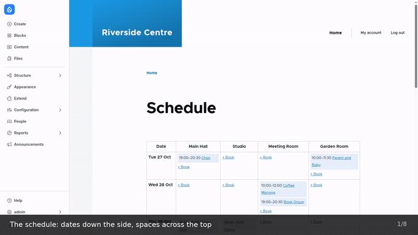
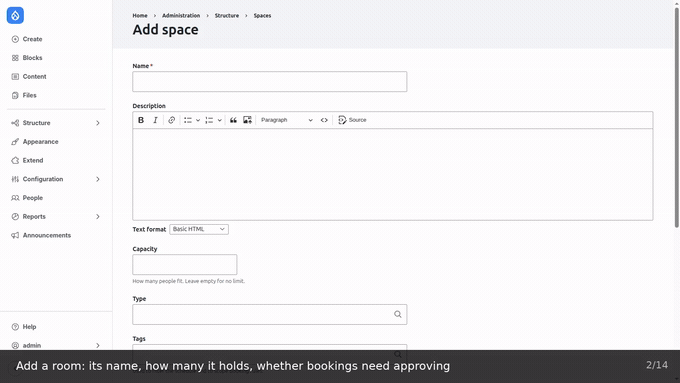
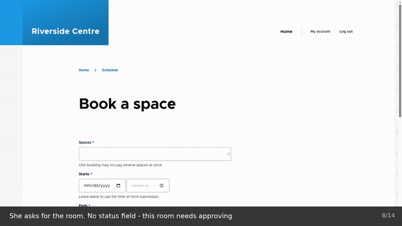

# Space Booking

Book venue spaces — halls, studios, rooms, courts, desks — against a time grid,
with configurable rules and optional approval.

Drupal 11, PHP 8.5+. No dependencies beyond core.

## See it working

Everything below is a plain `drupal/recommended-project` install — standard
profile, Olivero and Claro, `drush en space_booking`, nothing else added and
nothing themed. What you see is what the module gives you.

**Booking a space.** The schedule, then one short form: space, date, start and
end, a title, and optionally the content the booking is for. Then the same room
at the same hour again — refused, with the reason.



**Adding a room, and mapping what it overlaps.** A new space with its own
capacity and approval rule, mapped to the hall it physically sits inside.
Booking the Stage End is then refused because the hall around it is taken —
nobody ever booked the Stage End.



**Requesting a room that needs approval.** A member's form has no status, type
or holder: those are staff fields, so the module decides. Her booking is held as
a request — which already blocks the slot — and staff approve it from the queue.



Full-length 1600×900 MP4s are attached to the
[latest release](../../releases/latest):

| Download | Length | Covers |
|---|---|---|
| `schedule-and-booking.mp4` | 0:36 | the schedule, booking a space, linking it to a piece of content, a refused clash |
| `feature-tour.mp4` | 1:38 | adding and mapping a room, adding a user, permissions, a member's request and its approval, and the rules refusing a too-long booking and a closed day |
| `tutorial.mp4` | 2:27 | the whole setup from an empty install: rooms, overlaps, hours, rules, permissions, a member booking, an approval, a maintenance closure, and what gets refused |

## Setting up a venue

**[docs/TUTORIAL.md](docs/TUTORIAL.md)** is the written version of that last
one: a bare install through to a working booking system, with every setting and
permission explained, and the five refusals and their messages.

## Why this exists

Most Drupal booking modules model *events you sign up to*. This one models
*resources you reserve*: a community centre with three halls that can be hired
by the hour, where the same hall must never be promised to two people.

It is deliberately standalone. Nothing in it knows about any particular site,
so it can be dropped into any Drupal 11 install.

## What it does

- **Spaces** — bookable resources with capacity, type, tags, description and
  display order. A space can be marked *not bookable* (permanently assigned)
  while still appearing on the schedule.
- **Bookings** — a reservation of **one or more spaces** for a time range, held
  by a user. A booking is also how staff block a space: the `Internal use` and
  `Unavailable` types occupy the space without being public reservations, so
  there is a single source of truth about what is free.
- **Schedule** — a dates × spaces grid at `/bookings`, plus a JSON feed at
  `/bookings/data` for a calendar widget or an external consumer.
- **Approval** — spaces can require approval. Those bookings are held as
  *pending*, which still blocks the slot, and appear in a queue for staff.
- **Rules** — opening hours, slot size, minimum and maximum length, buffer
  between bookings, how far ahead people may book, and a weekly per-person
  allowance.

## The rules, and why they are validation constraints

Every rule is a Drupal entity validation constraint, not a check buried in the
booking form:

| Constraint | Enforces |
|---|---|
| `SpaceAvailable` | No overlap, space is bookable, end after start |
| `BookingDuration` | Minimum/maximum length and slot alignment |
| `BookingWindow` | Not in the past, minimum notice, maximum days ahead |
| `OpeningHours` | Inside opening hours, not overnight, not on a closed day |
| `BookingQuota` | Weekly allowance per person |

Because they hang off the entity, anything that saves a booking is checked —
the form, a migration, a REST call, a cron job. There is no path that skips
the rules, and each one can be tested in isolation.

## Design decisions worth knowing

**Half-open intervals.** A booking ending at 11:00 and one starting at 11:00 do
not overlap. Treating the end as inclusive loses an hour between every pair of
bookings.

**Pending holds the slot.** A request awaiting approval blocks its space. If it
released it, two people could be promised the same hour and the conflict would
only surface when staff approved the second one. Approving re-checks
availability for the same reason, and refuses if the slot has gone.

**Space conflicts are symmetrical.** A hall that divides into two halves is
three spaces. Booking the whole must block both halves and vice versa, so the
relationship is walked in both directions even though it is stored on one side.

**Local time, in one place.** Opening hours and weekly quotas are human ideas —
"Tuesday", "this week", "half past nine". `TimeWindow` is the only class that
converts between those and timestamps, so daylight saving is handled once. The
week containing a clock change really is 23 hours short, and the tests say so.

**Staff are not members.** Duration limits, opening hours and the booking
window apply only to public bookings. A caretaker must be able to record a
closure at 6am for nine hours.

## Installing

```bash
composer require vectorless/space_booking
drush en space_booking
```

Then:

1. **Structure → Space booking → Spaces** — add your spaces.
2. **Configuration → Content → Space booking** — slot size, opening hours, rules.
3. Grant permissions: *view space schedule*, *book a space*, and
   *approve booking requests* for staff.

## Permissions

| Permission | Lets someone |
|---|---|
| `view space schedule` | See the grid |
| `create space booking` | Make a booking |
| `edit own space bookings` | Change their own |
| `delete own space bookings` | Cancel their own |
| `view any space booking` | See who holds other bookings |
| `approve space bookings` | Work the approval queue |
| `administer space booking` | Everything, including spaces and settings |

Seeing the schedule does not reveal who holds each booking — the grid shows
that an hour is taken without naming the person. That needs
`view any space booking`.

## Tests

108 tests, 1277 assertions, verified on PHP 8.5.

```bash
# Unit — pure logic, no bootstrap
phpunit web/modules/custom/space_booking/tests/src/Unit

# Kernel — entities, validation, services
SIMPLETEST_DB=mysql://user:pass@db/db \
  phpunit web/modules/custom/space_booking/tests/src/Kernel

# Functional — the real journeys
SIMPLETEST_DB=... SIMPLETEST_BASE_URL=http://web \
  phpunit web/modules/custom/space_booking/tests/src/Functional
```

Coding standards:

```bash
phpcs --standard=Drupal,DrupalPractice .
```

## Not included

Deliberately out of scope for a first version, and straightforward to add:

- Interactive floor plans and maps
- Priced add-ons and payment
- Recurring bookings
- Per-space rule overrides (rules are currently venue-wide)
- Check-in and no-show release

## Licence

GPL-2.0-or-later, same as Drupal.
