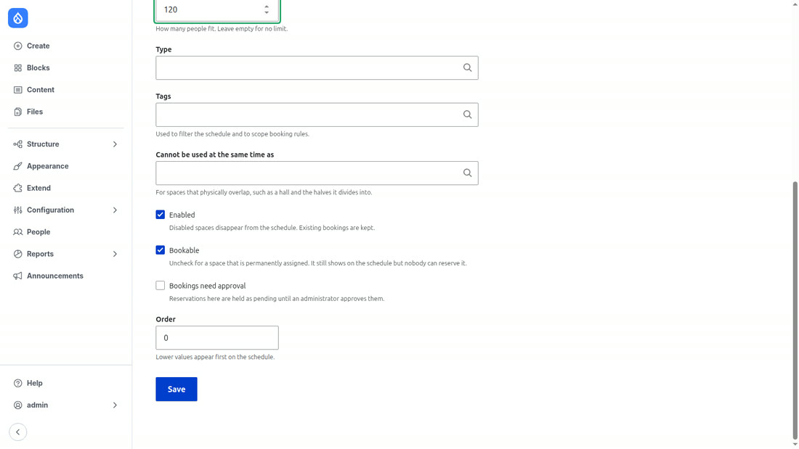
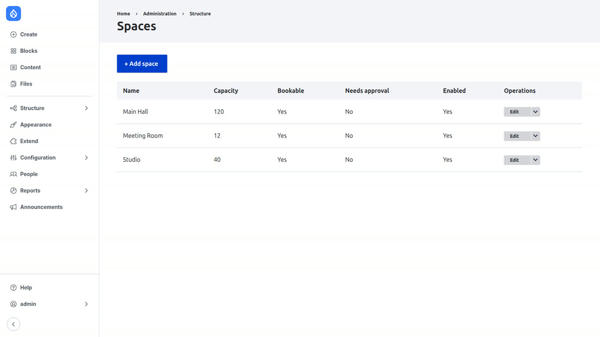
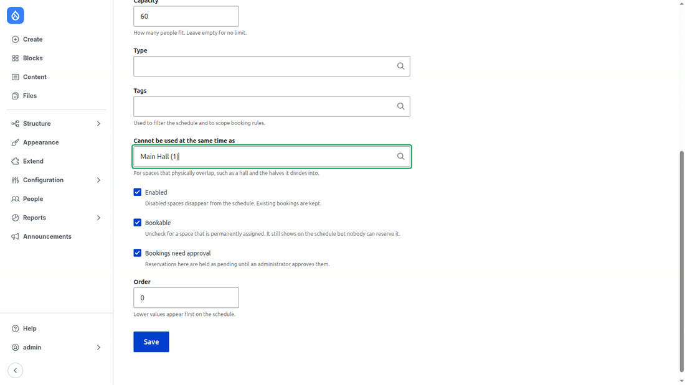
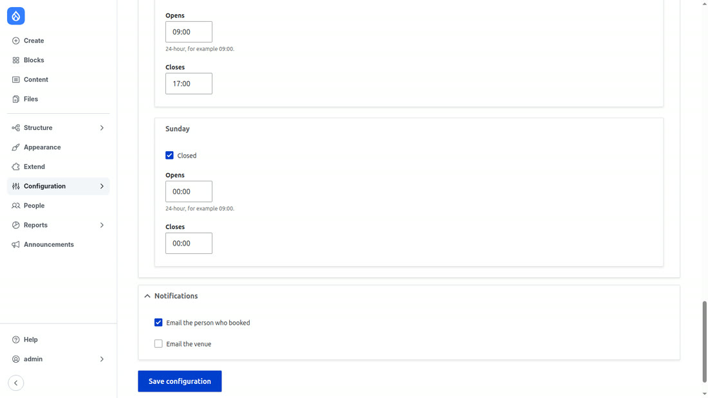
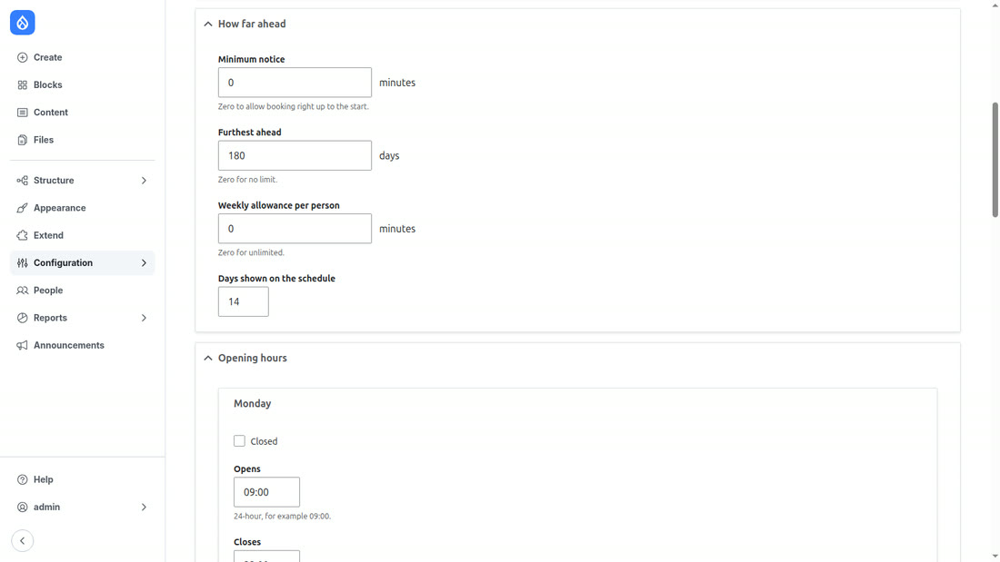
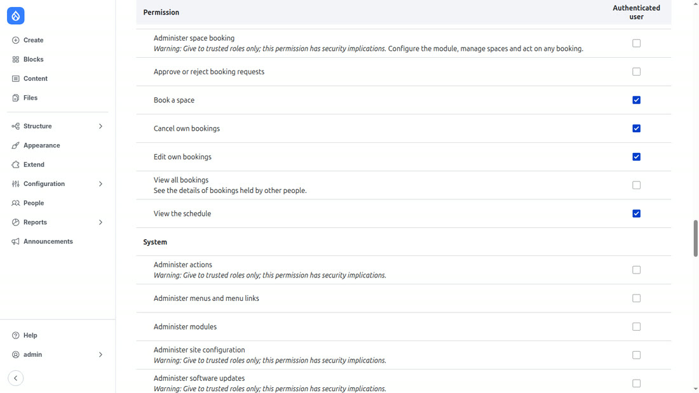
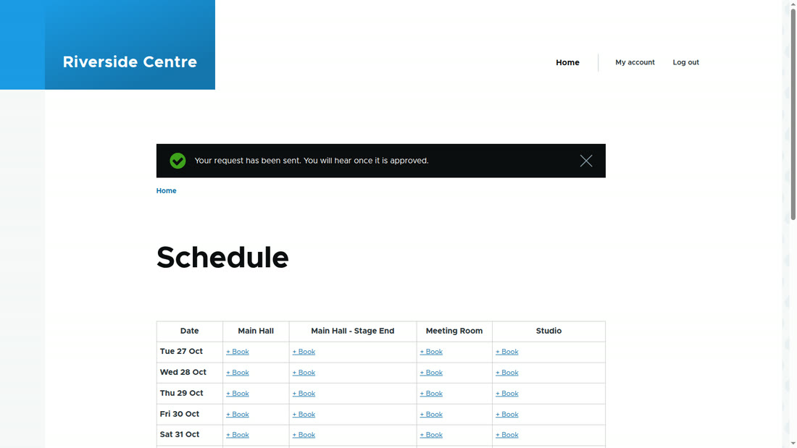
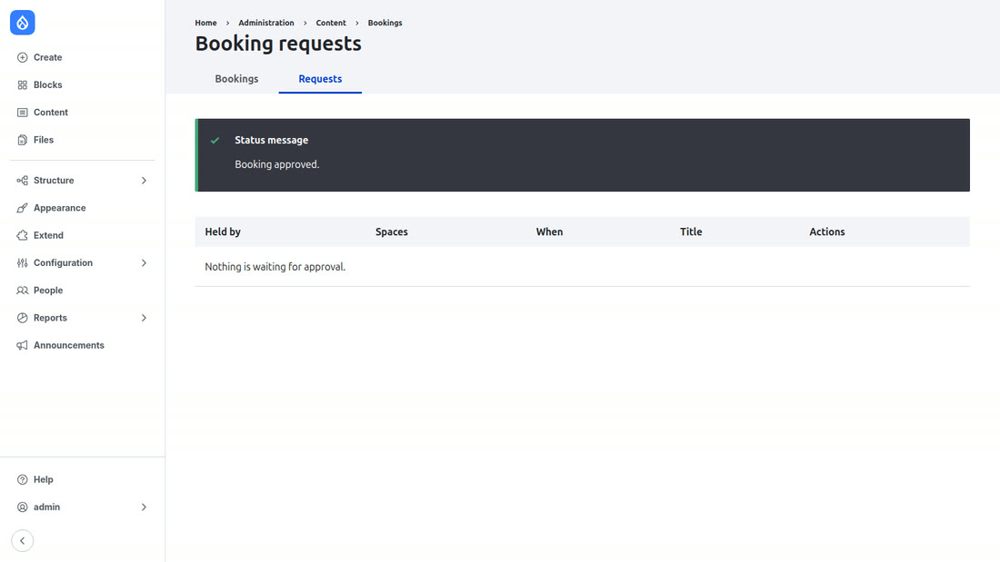
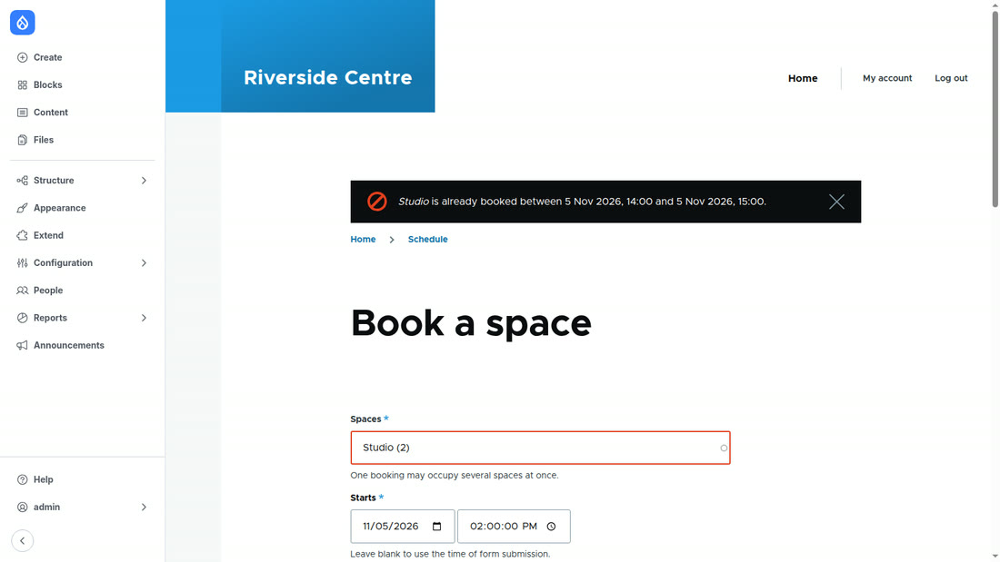
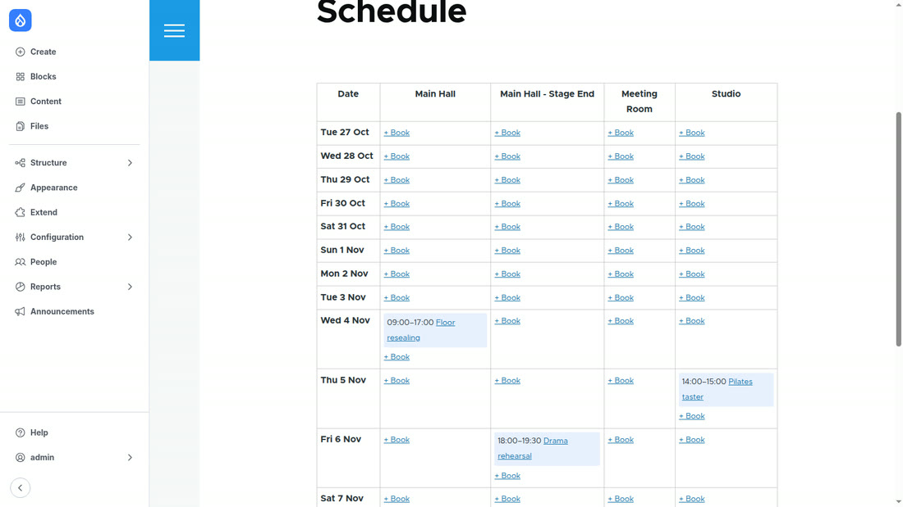

# Setting up a venue, end to end

This walks a bare Drupal site through to a working booking system: rooms,
opening hours, rules, who may book, a member making a reservation, and staff
approving one. It assumes only that **Drupal 11 is running and the module is
installed** — nothing else is configured.

Everything below was done on a plain `drupal/recommended-project` install
(standard profile, Olivero and Claro, no other contrib), and the screenshots
come from that site. There is a 2½ minute recording of this exact sequence
attached to the [latest release](../../releases/latest) as `tutorial.mp4`.

- [1. What you get on install](#1-what-you-get-on-install)
- [2. Add your rooms](#2-add-your-rooms)
- [3. Rooms that overlap](#3-rooms-that-overlap)
- [4. Opening hours](#4-opening-hours)
- [5. The booking rules](#5-the-booking-rules)
- [6. Who may do what](#6-who-may-do-what)
- [7. Someone books a room](#7-someone-books-a-room)
- [8. Approving a request](#8-approving-a-request)
- [9. Closing a room without booking it](#9-closing-a-room-without-booking-it)
- [10. What gets refused, and why](#10-what-gets-refused-and-why)
- [11. The schedule and the feed](#11-the-schedule-and-the-feed)

---

## 1. What you get on install

```bash
composer require vectorless/space_booking
drush en space_booking
```

Three things appear:

| Where | What |
|---|---|
| `/bookings` | the schedule — dates down the side, spaces across the top |
| **Structure → Space booking → Spaces** | the rooms you can book |
| **Configuration → Content → Space booking** | opening hours and the rules |

The schedule is empty and the space list says so: a fresh install has no rooms,
because only you know what your building contains.

## 2. Add your rooms

**Structure → Space booking → Spaces → Add space.**



A room needs a name. Everything else is optional:

| Field | What it does |
|---|---|
| **Name** | what appears as a column on the schedule |
| **Description** | shown to whoever is booking |
| **Capacity** | how many people fit. Empty means no limit |
| **Type**, **Tags** | taxonomy, for grouping and filtering rooms |
| **Cannot be used at the same time as** | see [section 3](#3-rooms-that-overlap) |
| **Enabled** | unticking removes it from the schedule; existing bookings are kept |
| **Bookable** | untick for a room that is permanently assigned — it still shows on the schedule, but nobody can reserve it |
| **Bookings need approval** | reservations here are held until staff approve them |
| **Order** | lower numbers appear first |

Add the rest of the building the same way. The list shows the settings that
matter at a glance:



## 3. Rooms that overlap

A hall that divides into halves is three rooms, not two: the whole, and each
half. Booking the whole must block both halves, and booking a half must block
the whole.

Create the sub-room, then fill in **Cannot be used at the same time as** with
the room it physically sits inside:



You record the relationship once, on one of the two rooms. The module walks it
in both directions, so you do not have to mirror it on the Main Hall.

This example also ticks **Bookings need approval**, which [section 8](#8-approving-a-request)
picks up.

## 4. Opening hours

**Configuration → Content → Space booking.**



One row per weekday, each with an opening time, a closing time, and a **Closed**
tick. Out of the box the venue is open 09:00–22:00 on weekdays, 09:00–17:00 on
Saturday, and closed on Sunday.

Hours are a *member-facing* rule. Staff recording a closure or an internal
event are not held to them — a caretaker must be able to block 06:00 for nine
hours on a Sunday.

## 5. The booking rules

Same page, above the hours:



| Setting | Default | What it means |
|---|---|---|
| **Accept bookings** | on | turning it off closes booking while leaving the schedule readable |
| **Slot size** | 15 min | bookings must start and end on this boundary |
| **Shortest booking** | 30 min | |
| **Longest booking** | no limit | |
| **Gap between bookings** | 0 | turnaround time kept free either side of every booking |
| **Minimum notice** | 0 | how long before the start somebody may still book |
| **Furthest ahead** | 180 days | |
| **Weekly allowance per person** | no limit | total booked minutes per person per week |
| **Days shown on the schedule** | 14 | |

Every one of these is enforced on the booking entity, not in the form, so an
import or a REST call is checked exactly like a person clicking Save.

## 6. Who may do what

**People → Permissions** (or the Permissions tab on a single role).



| Permission | Lets someone |
|---|---|
| `view space schedule` | see the grid |
| `create space booking` | make a booking |
| `edit own space bookings` | change their own |
| `delete own space bookings` | cancel their own |
| `view any space booking` | see who holds other people's bookings |
| `approve space bookings` | work the approval queue |
| `administer space booking` | everything, including rooms and settings |

Seeing the schedule does **not** reveal who holds each slot. The grid shows an
hour is taken without naming the person; that needs `view any space booking`.

For a community venue, granting the first four to *Authenticated user* is
usually right: anyone with an account can book, and staff keep the rest.

## 7. Someone books a room

With those permissions, a member goes to `/bookings`, finds a free hour and
clicks **+ Book** — which pre-fills the room and the day — or goes straight to
`/bookings/book`.

Their form is short: room, start, end, title, and optionally what the booking
is *for*. They do not see **Status**, **Type** or **Held by**; those are staff
fields, so the module decides the status for them.

In an ordinary room, that means confirmed immediately. In a room that needs
approval, it means a request:



A pending request **still blocks the slot**. If it released it, two people
could be promised the same hour and nobody would find out until staff approved
the second one.

## 8. Approving a request

**Content → Bookings → Requests**, or `/admin/content/bookings/approvals`.



Approving re-checks availability first. If something else took the slot while
the request was waiting, the approval is refused rather than creating a clash —
you are told to reject it or move it.

Rejecting releases the slot immediately.

## 9. Closing a room without booking it

Staff block a room by making a booking whose **Type** is `Internal use` or
`Unavailable`:

- **User booking** — a member's reservation. All the rules apply.
- **Internal use** — the venue's own programme.
- **Unavailable** — closed: maintenance, a private hire, a burst pipe.

Both non-public types occupy the room exactly like a reservation, so there is
one source of truth about what is free, and neither is held to opening hours or
duration limits.

## 10. What gets refused, and why

Every rule is a Drupal entity validation constraint. The messages come from the
constraint, not the form:

| Constraint | Refuses | Message |
|---|---|---|
| `SpaceAvailable` | a clash, a room that is not bookable, an end before its start | *Studio is already booked between 5 Nov 2026, 14:00 and 5 Nov 2026, 15:00.* |
| `BookingDuration` | too short, too long, off the slot boundary | *Bookings may be at most 2 hours long.* |
| `BookingWindow` | the past, too little notice, too far ahead | *Bookings can only be made up to 6 months in advance.* |
| `OpeningHours` | outside hours, overnight, a closed day | *The venue is closed on Sunday.* |
| `BookingQuota` | over the weekly allowance | *This would take Rachel over the weekly allowance of 3 hours. 30 min remains.* |



Note what the clash message names: book a sub-room while the hall around it is
taken and it tells you about **the hall**, because that is the booking in the
way.

## 11. The schedule and the feed



`/bookings` is the human view. `/bookings/data` is the same information as
JSON — spaces, then bookings with their ids, timestamps, status and type —
for a calendar widget, a screen in the foyer, or anything else:

```json
{"spaces":[{"id":1,"label":"Main Hall","capacity":120,"bookable":true}, ...],
 "bookings":[{"id":3,"spaces":[1],"start":1793782800,"end":1793811600,
              "status":"confirmed","type":"unavailable","label":"Floor resealing"}, ...]}
```

Both respect permissions: without `view any space booking`, the feed shows that
an hour is taken without saying who has it.

---

## Where to go next

- A booking can point at a piece of content — set `subject_entity_type` to the
  entity type, and `bookingsForSubject()` reads those dates back, so an event
  page can list its own sessions without storing them twice.
- Rules are venue-wide in this version. Per-space overrides, recurring
  bookings, paid add-ons, floor plans and check-in are deliberately not here;
  see **Not included** in the [README](../README.md).
